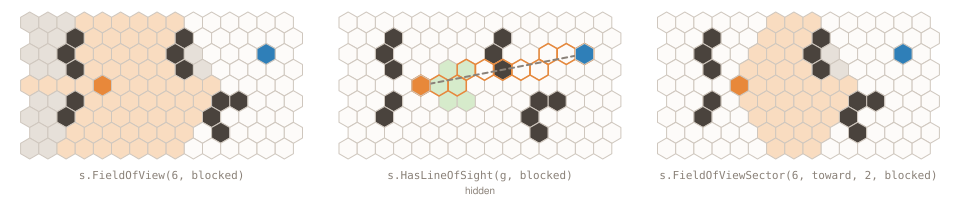
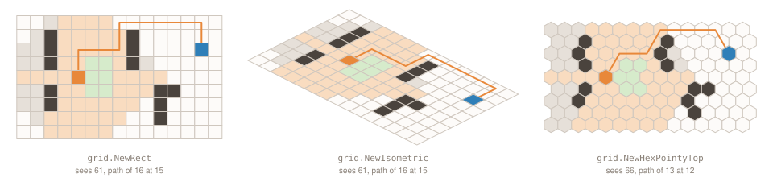

A 2D game asks the same two things of its map over and over: what can a unit see, and how does it get where it is
going. [Gravitton](https://github.com/gravitton) is a set of Go libraries for 2D games, written while building a
game engine on top of them, and three of them take that task, each at its own level:

- [`geometry`](https://github.com/gravitton/geometry): points, vectors, shapes, paths and the collisions between
  them.
- [`hexagon`](https://github.com/gravitton/hexagon): hexagonal coordinates, ranges, lines and sight, with no pixels
  and no storage.
- [`grid`](https://github.com/gravitton/grid): a value per cell on a rectangular, isometric or hexagonal layout,
  with sight and pathfinding, built on the other two.

Beside them are smaller ones: [`spatial`](https://github.com/gravitton/spatial) for the broad phase of collision,
[`container`](https://github.com/gravitton/container) for the storage under a grid,
[`errors`](https://github.com/gravitton/errors) and [`assert`](https://github.com/gravitton/assert). This post is
the map of the series: what the three libraries do on one map, the rules they share, and the posts that each take
one decision from them and show the code and the measurements behind it.

## The task

The README of each of the three opens with the same map:

```go
var rows = []string{
	"...............",
	"..#.....#......",
	"..#.....#....G.",
	"..#..~~.#......",
	"....S~~........",
	"..#..~~...##...",
	"..#.......#....",
	"..........#....",
	"...............",
}
```

`#` is a wall, `~` is rough ground, `S` is a scout and `G` its goal. What does the scout see, and how does it get to
the goal? Each library answers in its own terms, and the picture at the top of its README draws the answer.

## geometry

`geometry` takes the task in continuous space, where a wall is a shape and the scout a body that moves. Its shapes
are the circle, capsule, sector, polygon, rectangle, regular polygon, box and ellipse; its paths the segment, ray,
line, polyline, arc and Bézier curves. Between them it answers intersections, containment, raycasts, nearest points,
contacts and sweeps, and a `Shape` interface holds any shape without knowing which one. It knows nothing about
tiles.


{.plain}

In its hero a wall is a box and the scout a circle with a radius of a third of a tile. A sweep moves the circle along a
motion and reports where it first touches a shape:

```go
body := geom.Circ(scout, 1.0/3)
hit, ok := geom.Sweep[float64](body, goal.Subtract(scout), wall)
```

The hit holds the contact point, the normal there and the fraction of the motion made. Swept toward the goal, the
scout gets 35% of the way before the nearest wall stops it.

Every type is generic over its number type, so a `Point[int]` is a tile and a `Point[float64]` a position, with the
same methods written once. Every value is immutable: a method returns a new value and never changes its receiver.
It works in screen space, the origin top-left and `+Y` down, and comes with direction enums, `image` interop, JSON,
parsing and `geomtest` assertions.

## hexagon

`hexagon` takes it on hexes, as the math of a hexagonal grid. A `hex.Hex` is two integers in axial coordinates and a
map key. It knows its neighbors, its distances, its rings, spirals and sectors, the hexes on a line and what it can
see; it rotates and reflects in cube space, and converts losslessly to and from seven coordinate systems: axial,
offset and doubled. It knows nothing about where a hex is drawn or what a game stores in it.


{.plain}

The game says what blocks sight, and the library asks it:

```go
blocked := func(h hex.Hex) bool {
	return walls[h]
}

visible := scout.FieldOfView(6, blocked)
seen := scout.HasLineOfSight(goal, blocked)
```

On the hero map the scout sees 66 hexes within six, its own included, and the goal is hidden behind a wall. Line
of sight is exact and computed in integers, so it is symmetric: if the scout sees a hex, that hex sees the scout.

Every traversal has a `Seq` form, an iterator that walks the same hexes without allocating a slice for them.

## grid

`grid` takes the whole task, because it is where a map lives. A `Grid[T]` stores one value of any type per cell, in
one flat array, on a rectangular, isometric, flat-top or pointy-top hexagonal layout behind one API. It finds the
cell under a point and the center, bounds and polygon of every cell; it gives neighbors, ranges, rings and lines,
line of sight and field of view; it searches with A*, Dijkstra, greedy best-first and breadth-first; and it builds
regions of cells with set operations, borders, growth and components. It builds on `geometry` for its points and
shapes and on `hexagon` for its hexagonal coordinates.


{.plain}

Here each cell holds a `Tile` with a wall flag and a cost, and the same code runs on every layout; only the
constructor changes:

```go
g := grid.NewRect[Tile](size, grid.RectCellScale(17))

visible := g.FieldOfView(scout, 6, opaque)
path := g.Path(scout, goal, walkable, cost)
```

`opaque`, `walkable` and `cost` are callbacks that read the tile, so the grid never learns what a wall is.
`RectCellScale(17)` is the width of a cell when it is drawn; none of the answers depend on it. On the rectangular
layout the scout sees 61 cells and its path to the goal has 16 cells, both ends included. On the pointy-top layout
it sees 66, the same hexes `hexagon` gave above, because a hexagonal grid uses its sight unchanged.

## What they share

The three libraries share their rules. `geometry` sets them, and the other two follow them where they apply. Each
rule has a post of its own in this series, with the measurements that led to it:

- **Generic over number types**: one set of `geometry` methods for every integer and float type; `hexagon` and
  `grid` index their cells with integers. What that costs, and the compiler flag that takes it back, is
  .
- **Closed boundaries within a tolerance**: in `geometry`, a point on the edge of a shape is inside it, and two
  shapes that touch collide. Why, and where the rule is still wrong, is
  .
- **The same bits on amd64 and arm64**: in `geometry`, trigonometry aside, and in the fractional hexes of
  `hexagon`, so a replay recorded on one machine plays the same on another. The instruction that breaks it is
  .
- **No hidden allocations**: a slice result allocates at its final size, the documentation states every allocation
  beyond that, and a `Seq` form allocates nothing.
- **Degenerate inputs answer**: a zero-length segment or an empty polygon gives an answer, never a panic. A panic is
  only for an argument with no meaning, and it is an error that `errors.Is` matches, as
   shows.

Each library is tested to full coverage, with property checks and fuzz targets, on amd64 and arm64; how is
.

## The series

After the rules come the parts a game calls every frame, one post each:

- : contacts, sweeps and raycasts in `geometry`, and why a
  bullet never tunnels through a wall.
- : which pairs are worth testing, measured against
  a scan.
- : what `hexagon` adds to the
  classic guide.
- : the map above on three
  layouts.
- : A*, Dijkstra, breadth-first and flow fields, and the one
  case where A* is wrong.
- : the set under every area query, against a Go map.
-  and : the two
  smaller libraries the rest are built and tested with.
- : what tagging v1 too early cost, and
  what the engine does instead.

The engine built on all of them gets a series of its own after this one.

## Installation

```shell
go get github.com/gravitton/geometry
go get github.com/gravitton/hexagon
go get github.com/gravitton/grid
```

Each README has the full usage, with figures drawn from what the calls return, and the package documentation is
the reference:
[geometry](https://pkg.go.dev/github.com/gravitton/geometry), [hexagon](https://pkg.go.dev/github.com/gravitton/hexagon)
and [grid](https://pkg.go.dev/github.com/gravitton/grid).

Every number above comes from
[the code of this post](https://github.com/gravitton/blog/tree/main/content/posts/01-gravitton-libraries/code),
pinned to `geometry v1.18.0`, `hexagon v1.8.0` and `grid v1.3.0`.

 takes the first of the shared rules and measures what generics over
number types cost in Go.
